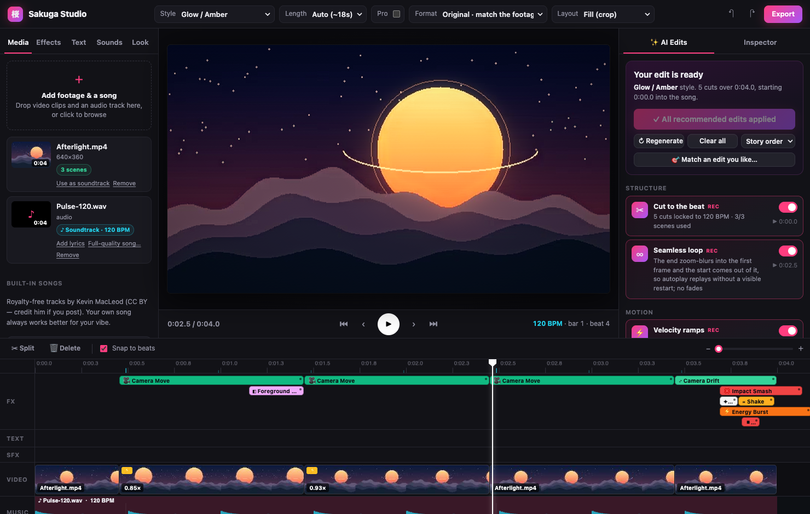

# Sakuga Studio

Sakuga Studio is a browser-based video editor for cutting footage to music. Drop in a clip and a song, and the editor proposes cuts against the beat grid. You can move a cut, change its speed, layer text over the frame, and export the result as an MP4.



## Run the editor

From a clone of this repository, start the local server with Python 3.9 or later.

```sh
git clone https://github.com/yslarid/sakuga-studio.git
cd sakuga-studio
python3 serve.py
```

Open [127.0.0.1:5178](http://127.0.0.1:5178) in desktop Chrome. On Windows you can run `py -3 serve.py`. The editor runs directly from the source files. Python serves them on the loopback interface.

Select **Open example** to load *Afterlight*, a four-second animation, and its original 120 BPM backing track. Watch the cuts against the waveform. Open **Text**, add a title at the playhead, then use **Export** to save an H.264 MP4. **Choose files** opens your own footage instead.

## Inside the editor

| If you’re interested in… | Start here |
| --- | --- |
| How a song becomes an edit | The [audio worker](js/analysis/audio-worker.js) finds beats and changes in energy. The [edit planner](js/engine/autoedit.js) matches those timings to scenes and proposes cuts. |
| What happens when you move a clip | The [timeline](js/ui/timeline.js) updates the [project state](js/state.js), including source timing, speed curves, and undo history. |
| How the preview becomes an MP4 | The [WebGL2 renderer](js/render/renderer.js) composites each frame. The [exporter](js/export/exporter.js) renders at the selected frame rate and passes the frames to WebCodecs for encoding. |
| How captions follow speech | The [caption pipeline](js/lyrics.js) aligns words to the audio. The [text layer](js/render/text.js) draws them at the playhead. |
| Working with media from the command line | The [local tools guide](docs/local-tools.md) covers the optional Python utilities, their inputs, and their dependencies. |

You can also inspect a finished render for repeated frames and jumps in camera motion. Install FFmpeg on your path, then run the optical-flow audit on a short segment.

```sh
python -m pip install -r tools/requirements/motion.txt
python tools/flowaudit.py examples/Afterlight.mp4 --t0 0 --t1 2 --out motion-report
```

## What runs locally

The editor reads media through the browser’s file picker or the bundled example. Editing and export run on the device. The timeline lives in the current tab, so export your work before reloading. The browser can reuse cached analysis between sessions.

The core editor works with the bundled files. Google Fonts and optional model runtimes or weights use the network. Speech transcription and subject masks download the selected models on first use. Optional RIFE interpolation accepts a compatible local model. To enable it, place your weights in `models/rife422lite_fp16.onnx` and set `interpolationModelPath` in [interp.js](js/render/interp.js) to `../../models/rife422lite_fp16.onnx`. By default the exporter uses the original frames. MP4 export requires WebCodecs and a browser with an H.264 encoder.

The [browser smoke test](tests/README.md) imports the example, checks undo and redo, and verifies the exported video and audio streams with FFprobe.

The source here covers the interactive editor and selected local tools. Third-party libraries and media carry their own terms. See the [credits and notices](THIRD_PARTY.md).
